<a href="https://portfoliomain-eosin.vercel.app/">
  <picture>
    <source media="(prefers-color-scheme: dark)" srcset="./assets/banner-dark.svg" />
    <source media="(prefers-color-scheme: light)" srcset="./assets/banner-light.svg" />
    
  </picture>
</a>

<p align="center">
  <a href="https://portfoliomain-eosin.vercel.app/"></a>
  <a href="https://linkedin.com/in/shourya-bafna-80a670215"></a>
  <a href="mailto:bafna.shourya2023@gmail.com"></a>
  <a href="https://leetcode.com/u/ShouryaW/"></a>
  <a href="https://codeforces.com/profile/Kraven"></a>
  <a href="https://www.codechef.com/users/algo_x_addict"></a>
</p>

### About me

```ts
const shourya = {
  role: "Full-stack & AI Engineer",
  studying: "B.Tech CS & AI @ Newton School of Technology",
  building: ["NextFlow", "Rashtram AI"],
  openSource: "Oppia: 3 pull requests in review",
  competitive: {
    codeforces: "1300+",
    codechef: "1600+",
    leetcode: "330+ solved",
  },
  ai: ["OpenAI", "Gemini", "Pinecone", "RAG", "scikit-learn"],
  learning: ["Docker", "AWS", "Supabase", "n8n"],
  funFact: "I debug faster than I cook Maggi 🍜",
};
```

### Tech stack

<p align="center">
  <picture>
    <source media="(prefers-color-scheme: dark)" srcset="https://skillicons.dev/icons?i=ts%2Cjs%2Cpy%2Ccpp%2Creact%2Cnextjs%2Ctailwind%2Chtml%2Ccss%2Cnodejs%2Cexpress%2Cpostgres%2Cmongodb%2Cprisma%2Cfirebase%2Cgit%2Cgithub%2Cvercel%2Cfigma%2Csklearn&perline=10&theme=dark" />
    <source media="(prefers-color-scheme: light)" srcset="https://skillicons.dev/icons?i=ts%2Cjs%2Cpy%2Ccpp%2Creact%2Cnextjs%2Ctailwind%2Chtml%2Ccss%2Cnodejs%2Cexpress%2Cpostgres%2Cmongodb%2Cprisma%2Cfirebase%2Cgit%2Cgithub%2Cvercel%2Cfigma%2Csklearn&perline=10&theme=light" />
    
  </picture>
</p>

### GitHub activity

<p align="center">
  <picture>
    <source media="(prefers-color-scheme: dark)" srcset="https://streak-stats.demolab.com/?user=shourya2006&theme=github-dark-blue&hide_border=true&ring=2DD4BF&fire=2DD4BF&currStreakNum=2DD4BF" />
    <source media="(prefers-color-scheme: light)" srcset="https://streak-stats.demolab.com/?user=shourya2006&hide_border=true&ring=0F766E&fire=0F766E&currStreakNum=0F766E" />
    
  </picture>
</p>

<p align="center">
  <picture>
    <source media="(prefers-color-scheme: dark)" srcset="https://raw.githubusercontent.com/shourya2006/shourya2006/output/github-contribution-grid-snake-dark.svg" />
    <source media="(prefers-color-scheme: light)" srcset="https://raw.githubusercontent.com/shourya2006/shourya2006/output/github-contribution-grid-snake.svg" />
    
  </picture>
</p>

### Holopin board

<p align="center">
  <a href="https://holopin.me/shourya2006"></a>
</p>

<p align="center">
  
</p>
